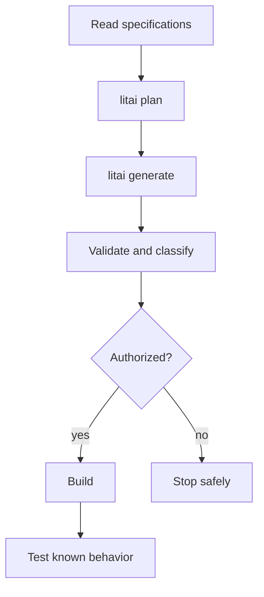

# Framework flow

[Project guide](../README.md) → framework flow

LeRTX's Standard lifecycle now binds to the published Literate AI 1.2.0 wheel
at `04d033b9ba0379bb70f0de54bcbc6d7f244d3831`. Parent lineage and framework
update provenance select the public GitHub release. The operator explicitly
retired the old initialization publisher. See
[FRAMEWORK-001](../roadmap/active-work.md) for migration evidence.

For this migration, use `_build/framework-migration/venv/bin/litai` from the
project root. The environment was installed from the official
[literate_ai-1.2.0-py3-none-any.whl](https://github.com/jordanhubbard/literate-ai/releases/download/v1.2.0/literate_ai-1.2.0-py3-none-any.whl),
with SHA-256 `e6ece36ee714ce30b4b63fc19dc880ce4838ca157e45607a3e524850d80c9686`.
This is a non-editable, project-local installation; global Litai is unchanged.
The reviewed transition is retained in
[the rebind plan](../../verification/framework-1.2.0-rebind-plan.json).
The previous environment and plan remain available for recovery. Rebinding does
not accept generated source or refresh test receipts: a new rebuild and acceptance
run are required before release qualification.

The desktop's Linux native candidate uses `--target linux` with
`--flavor=-flavor://literate-ai/os-macos` and
`--flavor=+flavor://lertx/desktop-linux`. This project-owned target includes the
observed CPython environment and exact verified dependency-lock data. Its lock
cannot be reused for a different interpreter or for Windows. Source generation
on the development host is not execution or native acceptance on that target.

Specifications define behavior; selected Flavors add target requirements; exact skills
guide conversion; workflows and routing constrain model work. By explicit operator
exception, `desktop/source` retains directly repaired generated source, with the
original generation archived for review. This exception does not grant it Standard
lifecycle admission or waive native/UI acceptance. Other generated source remains
disposable. The scaffold's `+bazel` selection is only a
removable prompt preference: explicit specification requirements and selected Flavors
take precedence, and `-bazel` removes it before prompt assembly.

Use the [project map](project-layout.md) to change the owning artifact, and read
[security](security.md) before compiling or running generated code.
